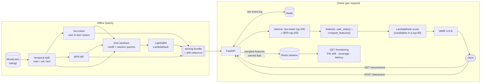
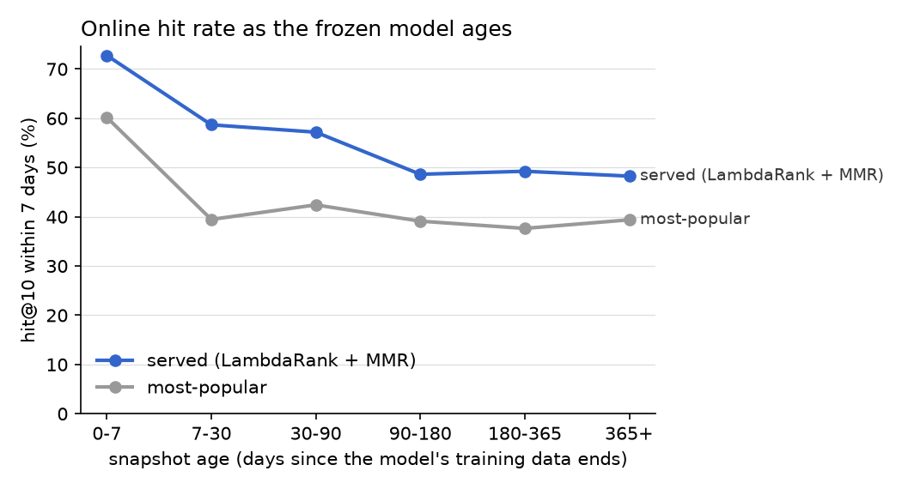

# recsys: an end-to-end, two-stage movie recommender

MovieLens-1M → temporal evaluation protocol → baselines → **two-tower retrieval** (logQ-corrected
sampled softmax, FAISS) → **LightGBM LambdaRank** ranking with MMR diversification → **FastAPI +
Redis** real-time serving in Docker → drift and exposure **monitoring**. Every number below comes
from a report in `reports/` produced by the code in this repo; none were typed in by hand.



## Results (MovieLens-1M, test period, ranked once per model)

The split is **global temporal** (train < val < test in time). Model selection always used the
**warm users of val**, because val is 55% cold-start users while test is 97.6% warm. All users,
k = 10 unless stated:

| Model | NDCG@10 | Recall@10 | Recall@100 | Coverage@10 | Report |
|---|---|---|---|---|---|
| most-popular (7-day window) | 0.219 | 0.067 | 0.270 | 3.2% | [baselines](reports/baselines_ml-1m.md) |
| item-KNN (cosine) | 0.249 | 0.064 | 0.290 | 6.9% | [baselines](reports/baselines_ml-1m.md) |
| ALS (`implicit`) | 0.257 | 0.071 | 0.327 | 6.7% | [baselines](reports/baselines_ml-1m.md) |
| BPR-MF (PyTorch) | 0.262 | 0.076 | 0.340 | 16.8% | [baselines](reports/baselines_ml-1m.md) |
| two-tower (logQ α=3) | 0.226 | 0.067 | 0.322 | 11.6% | [two-tower](reports/two_tower_ml-1m.md) |
| LambdaRank, trained on cutoff queries only | **0.273** | **0.103** | **0.373** | 12.7% | [ranker](reports/ranker_ml-1m.md) |
| **LambdaRank, cutoff + session queries** | 0.255 | 0.102 | 0.368 | 17.0% | [ranker](reports/ranker_ml-1m.md) |
| ... scoring only candidates in a retriever's top 80, + MMR λ = 0.8 (what is served) | 0.260 | 0.100 | - | 16.8% | [ranker](reports/ranker_ml-1m.md) |

* **The offline protocol and serving reward different rankers.** The protocol asks each
  user once, at the snapshot cutoff; the API is asked mid-session. Trained on cutoff
  queries only, the ranker wins every offline column (+4% NDCG@10 and +36% Recall@10 over
  BPR). Trained also on *session* queries (decision time inside the label period, history
  up to that moment, models frozen) it gives up 7% offline NDCG, gains 17% NDCG on
  held-out session queries, and **wins the online replay by 5 pp of hit rate** (below).
  The served model is the second one; [why it exists](#monitoring-replaying-the-test-period-through-the-live-path).
* Either way the ranker mostly arbitrates between the retrievers: their *ranks* carry 27%
  of the split gain, their raw scores 9%.
* The **two-tower model alone does not beat BPR** on ML-1M (Recall@200 0.470 vs 0.495). Tuning
  found one knob that mattered: the logQ correction strength α (val Recall@200 0.429 at α=1 →
  0.492 at α=3); without correction, retrieval collapses to the long tail (Recall@200 0.161).
* The candidate union reaches **57% of test positives**: that, not the ranker, caps Recall@100.
* Serving scores only candidates some retriever ranked in its top 80 (~110 of ~270): 58%
  fewer rows through LightGBM for −0.8% held-out NDCG (rule: smallest cap within 1%).
* MMR at λ = 0.8 (rule fixed in advance, applied on held-out val users: smallest λ within 1%
  of λ = 1's NDCG) costs nothing on test NDCG (0.2599 → 0.2602) for +3% catalog coverage
  and higher genre diversity, a metric MMR does not optimize.

### Serving latency (Docker, 4 workers x 1 ranker thread, Locust on the same 8-core laptop)

After levers 1-4 below (LightGBM backend; lever 5, the compiled trees, has its own A/B after the list):

| load | /recommend p50 | **p95** | p99 | p95 before the latency work | first ranker's p95 |
|---|---|---|---|---|---|
| 29 req/s | 11 ms | **24 ms** | 64 ms | 29 ms | 21 ms |
| 70 req/s | 13 ms | **45 ms** | 92 ms | 59 ms | 32 ms |
| 101 req/s | 19 ms | 130 ms | 220 ms | 210 ms | 58 ms |
| 125 req/s | 26 ms | 210 ms | 360 ms | 420 ms | 140 ms |

p95 < 50 ms holds up to ~70 recommendations/s on this machine, close to the first ranker's
~75, with the better ranker. The session-trained ranker needs 292 trees (vs 23), and
LightGBM was half of each request, so the work went where the profile pointed:

1. **Fewer trees: rejected by the rule.** A learning-rate grid (0.05-0.3) found 10-190-tree
   models, but none within 1% of the best held-out NDCG; the 292-tree model stays.
2. **Fewer rows: accepted.** Score only candidates some retriever ranked in its top 80:
   ~110 rows instead of ~270, every kept row's features unchanged, −0.8% held-out NDCG.
3. **No pandas on the request path.** The API stacks the same feature columns straight
   into LightGBM's float matrix (one implementation, `feature_columns`; training wraps it
   in a DataFrame), cutting Python calls per request by more than half.
4. **One LightGBM thread per worker**, so 4 workers don't oversubscribe 8 cores.
5. **Compiled trees: accepted.** `lleaves` compiles the same 292 trees to native code via
   LLVM: predict 2.44 → 0.49 ms per request, **bit-identical** scores (its default tree
   blocking is 2x faster still but reorders the float sums, max diff 6e-15; turned off).
   The binary is CPU-specific, so the container compiles it on a model's first start
   (~3 min; kept in a volume after) and every worker checks it against LightGBM before
   serving; any mismatch falls back to LightGBM.
6. **User tower in numpy: accepted.** The profile below put the torch user vector at 14%
   of samples (tiny tensors, per-op dispatch). The same trained weights in numpy compute
   it 7x faster (0.31 → 0.044 ms) and agree with torch to 1.5e-7; recommend() p50 4.64 →
   3.99 ms in a same-process A/B, top-10 identical 1000/1000. Torch stays for training.
7. **One socket per worker: accepted.** With `uvicorn --workers`, workers race to accept on
   one shared socket and keep-alive connections stay where they landed: the busiest worker
   got 1.9-2.0x the quietest's requests at 100 users. `recsys.serving.launch` gives each
   worker its own `SO_REUSEPORT` socket so the kernel spreads connections: 1.23-1.70x, and
   server p95 65 → 50-53 ms in both rounds (better or equal balance in all 5 A/B pairs).

In-process, one request: p50 3.9 ms / p95 5.5 ms (LightGBM path, same run: 6.1 / 9.0; before
the latency work: 9.2 / 13.1). Under load, an interleaved A/B (Redis reseeded before every
level, two rounds per backend, 0 failures), /recommend p95:

| load | LightGBM (round 1 / 2) | compiled (round 1 / 2) |
|---|---|---|
| ~70 req/s | 49 / 56 ms | **45 / 45 ms** |
| ~100 req/s | 180 / 130 ms | **120 / 63 ms** |
| ~128 req/s | **180 / 150 ms** | 250 / 170 ms |

Compiled wins at ~70-100 req/s in both rounds; at ~128 req/s it lost both, by less than the
round-to-round spread. **A py-spy profile under load explains why that row means little:**

* **Not CPU-bound.** At ~140 req/s the API uses 1.3-2.2 of 8 cores and Redis 7%; the ranker
  is 5% of samples (13% with LightGBM), the two-tower torch step 14%, HTTP plumbing 21%.
* **The tail is GIL sharing.** A worker runs up to 40 requests at once on one GIL, so each
  absorbs its neighbours' Python time: the service's own p95 is 6-9x its p50, and even a
  one-round-trip Redis read has p95 8x its median.
* **More processes help; capping alone doesn't.** 8 workers x 1 request gave p95 53 / 55 ms
  at ~140 req/s in both rounds (default 4 x 40: 200 / 68 ms; 4 x 1: 210 / 380 ms).
* **This laptop is the noise floor.** Identical runs differ up to 4x above ~100 req/s, so
  defaults stay; `WEB_CONCURRENCY` / `THREADPOOL_TOKENS` are there for a dedicated host.

Details and flamegraphs: [serving report](reports/serving_ml-1m.md), `reports/profiles/`.
Serving builds features with the same functions as training; on 200 real test users the
served top-10 equals the offline ranker's top-10 for 200/200, under either backend.

### Monitoring: replaying the test period through the live path

`python -m recsys.monitoring.simulate` freezes the bundle at the end of val, then walks the real
100,021 test-period interactions in time order with a simulated clock: before 5% of them the user
requests recommendations (4,998 requests, logged exactly as the API logs them), then the event is
written to Redis as `POST /interaction` would. Because the future is known, every served list is
scored against what the user actually liked in the next 7 days, and so is the most-popular list
for the same user at the same moment ([monitoring report](reports/monitoring_ml-1m.md)).



| snapshot age (days) | 0-7 | 7-30 | 30-90 | 90-180 | 180-365 | 365+ | overall |
|---|---|---|---|---|---|---|---|
| **hit@10, served ranker** | **72.8%** | **58.7%** | **57.2%** | **48.6%** | **49.2%** | **48.3%** | **53.5%** |
| hit@10, first ranker (before the fixes below) | 63.4% | 48.0% | 56.4% | 47.9% | 44.7% | 46.7% | 49.7% |
| hit@10, fixed features but cutoff-only training | 61.1% | 48.5% | 52.4% | 43.1% | 44.6% | 46.9% | 48.3% |
| hit@10, most-popular | 60.2% | 39.5% | 42.4% | 39.1% | 37.6% | 39.4% | 41.4% |
| catalog coverage, served | 13.2% | 18.6% | 19.1% | 20.1% | 21.9% | 24.4% | |

All three rankers answered the same 4,998 requests (same seed, same events). Unpaired
standard errors, conservative for identical requests: about 1 pp overall and 3 pp in
week one, so served vs the first ranker (+3.8 pp overall, +9.4 pp in week one) and vs
cutoff-only training (+5.2 pp overall) are well outside noise. Scoring only the top-80
candidates left the served hit rate where it was (53.6% uncapped, 53.5% capped).

**How the drift monitor got there.** The first ranker's replay raised the PSI alarm on
day 0, and the drifted features were design flaws, not a changing world:

| finding (first ranker, week one) | cause | fix | after (served ranker, week one) |
|---|---|---|---|
| `item_age_days` PSI 7.2 | in ML-1M almost every movie was first rated in mid-2000, so "age" is days since the dataset began: a clock | dropped (release year stays) | gone; with BPR's fix too, the cutoff-only ranker's test NDCG barely moves (0.281 → 0.279, [v2 report](reports/ranker_ml-1m_v2.md)) |
| `user_days_since_last` PSI 5.6: mean 15.2 days in training, 0.6 at serving | training asked every user at the window cutoff; serving is asked mid-session. A **point-in-time mismatch** the parity test cannot see (it compares offline and online at the same moment) | train on **session queries** too: decision time = a random label-period event, history up to it, models frozen ([queries.py](src/recsys/ranking/queries.py)) | PSI 1.6: training mean 3.7 days; the remaining gap is the 14% of training rows that are cutoff queries |
| `bpr_score` mean 2.7 in training vs 266 at serving | users whose first like comes after the snapshot have no BPR vector; the fallback returned popularity *counts* | score is NaN for users BPR doesn't know, in one function shared by training and serving | no longer in the top drifted features |

`item_log_pop_7d` (4.0 → 2.0) is the one genuine data drift: MovieLens activity collapses
after 2000. It stays flagged, as it should.

Two lessons. First, **large PSI did not mean lost accuracy** (the first ranker kept its
lead over popularity for two years at PSI ≈ 7); PSI is a cheap alarm, and the replay's
outcome metric is what says whether drift matters. Second, **the offline protocol picked
the wrong model**: the cutoff-only ranker is best on test NDCG and worst of the three
online. The evaluation that matched serving (held-out session queries, then the replay)
chose correctly.

## Design decisions and trade-offs

| Decision | Why | Cost / what it gives up |
|---|---|---|
| Global temporal split, not random or leave-last-N | Random splits leak the future; leave-last-N leaks global trends (other users' later ratings train the model) | val/test sizes and cold-start mix are uneven, so selection uses warm val users |
| Seen items filtered before top-k | Otherwise models "recommend" what the user already rated and recall is inflated | - |
| logQ-corrected in-batch softmax | In-batch negatives oversample popular items; correction makes the sampled softmax estimate the full one | α became a tuned popularity dial (α>1 leans popular) rather than a theoretical constant |
| Two retrievers + ranker | Each retriever's top list misses things the other finds; the ranker learns when to trust which | Two models to retrain and serve; BPR user vectors only update at bundle rebuild |
| Ranker trained on later time windows | Labels must come after everything candidates and features were fit on, or the ranker learns to trust inflated retriever scores | Only two windows: 6,907 training queries (1,026 w1 users + 828 non-held-out w2 users) |
| Training queries at request time, not only at the cutoff | Serving asks mid-session with fresh history and frozen models; a ranker that only saw cutoff queries learned "days since last interaction" on a 15-day scale and is asked at 0.6 days | Worse on the cutoff-only offline protocol (NDCG 0.279 → 0.255); better online (+7 pp hit rate). Selection uses all held-out queries of both kinds |
| A retriever with no vector for a user gives a *missing* score | BPR's factors freeze at bundle time; its popularity fallback is in counts (mean 266 vs 2.7), a different unit the ranker would misread | The fallback still supplies candidates and ranks; only the score feature is NaN |
| No calendar features | "Item age" on a dataset collected in one burst is days since the dataset began: a clock | Release year stays; it carries the real item-age signal |
| Redis stores raw events, not features | One feature implementation (`user_state`) for training and serving: no skew by construction | Recompute per request (~4 ms CPU in-process); fine at this scale |
| Score only candidates in some retriever's top 80 | LightGBM cost is linear in rows, and candidates every retriever ranks low almost never reach the top 10 | −0.8% held-out NDCG; ranks and n_sources still come from the full top-200 lists, so kept rows' features are unchanged |
| One `SO_REUSEPORT` socket per worker (own launcher, not `uvicorn --workers`) | The shared socket's accept race left one worker with ~2x another's load; the kernel's connection hash spreads it | ~100 lines of supervision we own (signals, restarts, crash-loop guard); balances connections, not requests; Linux/macOS only (`SERVER_SOCKETS=shared` falls back) |
| One LightGBM thread per request | 4 workers x all-cores prediction oversubscribes 8 cores under load (p95 at 100 req/s: 170 ms default vs 110 ms with 1 thread, same sweep) | An idle single request is slower (6.4 vs 3.4 ms predict); `RANKER_NUM_THREADS` sets it |
| Compiled trees (lleaves), verified at every start | 5x faster prediction with bit-identical scores; the check catches a stale or foreign binary, which lleaves itself never detects | A native LLVM dependency (llvmlite pinned < 0.45: lleaves 1.3 needs the legacy pass manager), ~3 min compile on a model's first start (blocking off puts all 292 trees in one function for LLVM; the default blocking compiles in 33 s), cached in a volume after |
| Exact search, not ANN, for 3.9k items | Exact is 0.1 ms; HNSW/IVF only win on large catalogs (18× faster at 300k items in our benchmark) | Swap in the exported HNSW index for ML-25M-scale catalogs |
| Explicit decision clock for time features | A frozen snapshot cutoff makes "days since last interaction" go negative after new events | Serving must choose: snapshot clock (offline-faithful demo) or wall clock (production) |
| Drift reference sampled like serving logs | 10 random candidate rows per warm request on both sides, so PSI compares like with like | Only personalized requests are monitored for feature drift (cold-start ones have no features) |

## Quick start

```bash
python -m venv .venv && .venv/Scripts/activate     # Linux/macOS: source .venv/bin/activate
pip install --extra-index-url https://download.pytorch.org/whl/cpu -e ".[train,serve,dev,loadtest]"

python -m recsys.data all --config configs/data/ml-1m.yaml          # download, preprocess, split
python -m recsys.pipelines.baselines --data-config configs/data/ml-1m.yaml --config configs/baselines.yaml
python -m recsys.pipelines.two_tower --data-config configs/data/ml-1m.yaml --config configs/two_tower.yaml
python -m recsys.pipelines.ranker    --data-config configs/data/ml-1m.yaml --config configs/ranker.yaml
python -m recsys.serving.bundle      --data-config configs/data/ml-1m.yaml --ranker-config configs/ranker.yaml

docker compose up --build              # API :8000, Redis :6379, MLflow UI :5000
curl "localhost:8000/recommend?user_id=24&k=10"
curl -X POST localhost:8000/interaction -H "content-type: application/json" \
     -d '{"user_id": "1", "item_id": "1", "rating": 5}'
curl "localhost:8000/monitoring?last=5000"

locust -f loadtest/locustfile.py --host http://localhost:8000 --headless -u 50 -r 10 -t 60s
python -m recsys.monitoring.simulate --redis-url redis://localhost:6379/1   # replay + drift report
pytest                                   # 114 tests; real-data ones skip if artifacts are absent, launcher ones off Linux/macOS
```

MovieLens-25M is a config switch (`configs/data/ml-25m.yaml`). All experiments log to MLflow
(`sqlite:///mlflow.db`).

## Layout

```
configs/               data, baselines, two-tower (+ tuning), ranker settings
src/recsys/data/       download (checksummed), preprocessing, temporal splits, EDA stats
src/recsys/eval/       metrics written from scratch (Recall/NDCG/HR/MRR, coverage, ARP, ILD) + protocol
src/recsys/models/     most-popular, item-KNN, ALS, BPR, two-tower; cold-start fallback
src/recsys/features/   item/user encoders, history tokens, ranking features (shared with serving)
src/recsys/retrieval/  FAISS Flat / IVF / HNSW + benchmarks
src/recsys/ranking/    decision-time queries, candidate union, LambdaRank, MMR
src/recsys/pipelines/  baselines, two-tower, ranker: train → select on val → test once → report
src/recsys/serving/    bundle, Redis store + event log, service, FastAPI app, JSON logging, launcher
src/recsys/monitoring/ PSI drift, exposure, drift reference, test-period replay
tests/                 114 tests: metrics by hand, leakage guards, skew/parity, API, monitoring
notebooks/01_eda.ipynb plots only; all statistics come from tested functions
reports/               every result table and figure quoted above
```

## What I'd do next

1. **Match the training population, not just the timing.** Session queries fixed the
   timing, but 52% of training rows have no BPR vector (w2 is full of users who joined
   during val) against ~0% after the first month of serving, so `bpr_score` drifts on
   missingness. Reweight training queries toward the serving mix, or fold new users into
   BPR (item 4), which removes the gap at its source.
2. **Widen the candidate pool before tuning the ranker further.** The union catches 57% of test
   positives; a third source (item-KNN on recent likes) or k = 500 likely raises the ceiling more
   than any ranker change.
3. **More windows, paired replay stats.** Rolling cut points instead of two windows (session
   queries already took the ranker from 23 to 292 trees); and save per-request replay
   outcomes so ranker A/B comparisons get paired tests instead of conservative unpaired SEs.
4. **Online-updatable BPR or drop it.** Its user vectors freeze at bundle time; a fold-in step
   (solve for the user vector from their history) would make it as fresh as the two-tower path.
5. **Load-test on a quiet machine, then cut the GIL time.** The profile shows the tail is
   requests sharing a worker's GIL, not CPU, and this laptop's run-to-run spread (up to 4x)
   hides anything finer. On a dedicated Linux host with Locust elsewhere: sweep workers x
   concurrency (8 x 1 looked best here) with per-worker sockets, and if a few busy keep-alive
   clients still pile onto one worker, add per-request balancing (a least-connections proxy
   in front of the workers), then shrink per-request
   Python time where the profile points next (feature_columns 9%, the monitoring log 7.5%,
   a per-user feature cache between a user's interactions).
6. **Scale to ML-25M**: HNSW for retrieval, approximate feature freshness (stream item-popularity
   counters into Redis instead of batch), and a per-user feature cache invalidated on interaction.
7. **Monitoring that pages someone**: export `/monitoring` to Prometheus and alert on PSI > 0.25
   for top-gain features or a cold-start share jump; schedule bundle rebuilds on drift.
