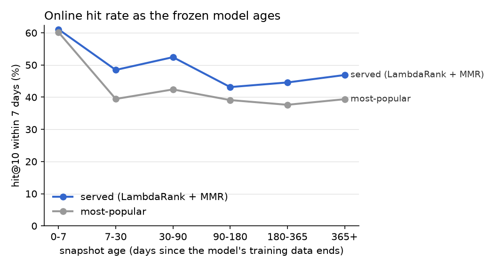

# Monitoring replay: ml-1m test period through the live serving path

Bundle 20261119-205219 (frozen at the end of val). Replayed 100,021 test-period interactions in time order; before each one the user requested recommendations with probability 0.05 (4,998 requests). Hit = the 10-item list contains at least one movie the user liked within the next 7 days (requests followed by no like are excluded). 'Popular' is the most-popular list for the same user at the same moment, evaluated on the same future.

| snapshot age (days) | requests | with future likes | hit@10 served | hit@10 popular | coverage | avg popularity | max PSI (noise floor) | major / moderate features |
|---|---|---|---|---|---|---|---|---|
| 0-7 | 450 | 437 | 61.1% | 60.2% | 7.0% | 1573 | 7.41 (0.002) | 8 / 2 |
| 7-30 | 612 | 588 | 48.5% | 39.5% | 11.8% | 1206 | 7.51 (0.001) | 6 / 5 |
| 30-90 | 771 | 738 | 52.4% | 42.4% | 15.3% | 1195 | 7.54 (0.000) | 6 / 3 |
| 90-180 | 736 | 693 | 43.1% | 39.1% | 17.1% | 1080 | 7.54 (0.000) | 7 / 3 |
| 180-365 | 986 | 922 | 44.6% | 37.6% | 18.3% | 1126 | 7.54 (0.000) | 6 / 2 |
| 365+ | 1443 | 1318 | 46.9% | 39.4% | 21.6% | 1117 | 7.55 (0.000) | 9 / 1 |

Overall hit@10 (7 days): served 48.3%, popular 41.4%.

### Most drifted features, snapshot age 0-7 days (4480 sampled rows)

| feature | PSI | status | training mean | serving mean |
|---|---|---|---|---|
| item_log_pop_7d | 7.411 | major | 4.3 | 2.45 |
| user_days_since_last | 5.598 | major | 15.2 | 0.635 |
| bpr_score | 3.010 | major | 3.38 | 3.28 |
| item_log_pop_30d | 2.454 | major | 5.4 | 4.68 |
| user_span_days | 0.839 | major | 26.4 | 27.7 |
| user_mean_log_pop | 0.404 | major | 5.87 | 6.13 |
| user_occupation | 0.371 | major | 10.2 | 9 |
| item_log_n_ratings | 0.270 | major | 6.82 | 7.07 |

### Most drifted features, snapshot age 7-30 days (6120 sampled rows)

| feature | PSI | status | training mean | serving mean |
|---|---|---|---|---|
| item_log_pop_7d | 7.509 | major | 4.3 | 2.24 |
| user_days_since_last | 4.283 | major | 15.2 | 1.93 |
| user_span_days | 3.943 | major | 26.4 | 81.5 |
| item_log_pop_30d | 2.879 | major | 5.4 | 4.46 |
| user_n_pos | 0.466 | major | 129 | 184 |
| user_n_ratings | 0.343 | major | 224 | 324 |
| user_mean_log_pop | 0.219 | moderate | 5.87 | 6 |
| x_sim_recent_mean | 0.158 | moderate | 0.415 | 0.364 |

### Most drifted features, snapshot age 30-90 days (7710 sampled rows)

| feature | PSI | status | training mean | serving mean |
|---|---|---|---|---|
| item_log_pop_7d | 7.538 | major | 4.3 | 2.27 |
| user_span_days | 4.424 | major | 26.4 | 127 |
| user_days_since_last | 4.405 | major | 15.2 | 2.76 |
| item_log_pop_30d | 2.882 | major | 5.4 | 4.5 |
| user_n_pos | 0.371 | major | 129 | 195 |
| user_n_ratings | 0.348 | major | 224 | 337 |
| user_mean_log_pop | 0.237 | moderate | 5.87 | 5.99 |
| user_mean_year | 0.197 | moderate | 1.99e+03 | 1.99e+03 |

### Most drifted features, snapshot age 90-180 days (7360 sampled rows)

| feature | PSI | status | training mean | serving mean |
|---|---|---|---|---|
| item_log_pop_7d | 7.542 | major | 4.3 | 2.23 |
| user_span_days | 6.138 | major | 26.4 | 200 |
| user_days_since_last | 4.057 | major | 15.2 | 5.37 |
| item_log_pop_30d | 2.980 | major | 5.4 | 4.45 |
| user_n_ratings | 0.641 | major | 224 | 381 |
| user_n_pos | 0.604 | major | 129 | 222 |
| x_sim_recent_mean | 0.258 | major | 0.415 | 0.346 |
| user_mean_year | 0.239 | moderate | 1.99e+03 | 1.99e+03 |

### Most drifted features, snapshot age 180-365 days (9840 sampled rows)

| feature | PSI | status | training mean | serving mean |
|---|---|---|---|---|
| item_log_pop_7d | 7.544 | major | 4.3 | 2.25 |
| user_span_days | 5.996 | major | 26.4 | 336 |
| user_days_since_last | 3.718 | major | 15.2 | 7.06 |
| item_log_pop_30d | 2.937 | major | 5.4 | 4.47 |
| user_n_ratings | 0.437 | major | 224 | 356 |
| user_n_pos | 0.373 | major | 129 | 198 |
| x_sim_recent_mean | 0.186 | moderate | 0.415 | 0.362 |
| bpr_score | 0.137 | moderate | 3.38 | 3.23 |

### Most drifted features, snapshot age 365-10000 days (14430 sampled rows)

| feature | PSI | status | training mean | serving mean |
|---|---|---|---|---|
| item_log_pop_7d | 7.545 | major | 4.3 | 2.21 |
| user_span_days | 6.243 | major | 26.4 | 618 |
| user_days_since_last | 3.595 | major | 15.2 | 8.95 |
| item_log_pop_30d | 2.990 | major | 5.4 | 4.42 |
| user_n_ratings | 0.667 | major | 224 | 406 |
| user_n_pos | 0.609 | major | 129 | 229 |
| x_sim_recent_mean | 0.343 | major | 0.415 | 0.346 |
| user_mean_year | 0.285 | major | 1.99e+03 | 1.98e+03 |
