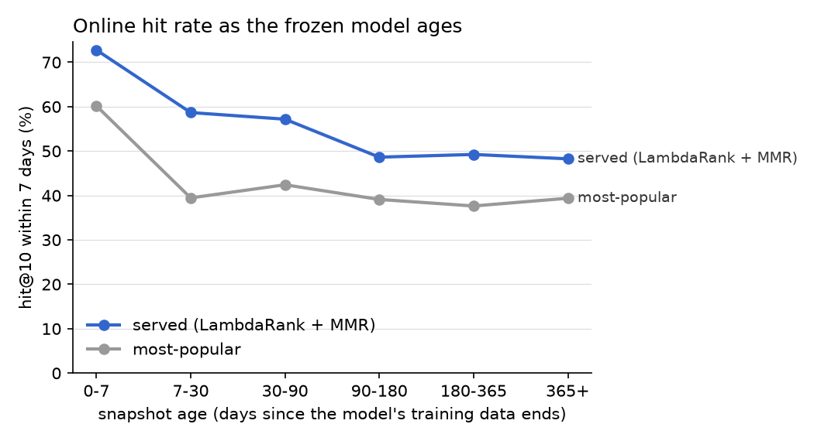

# Monitoring replay: ml-1m test period through the live serving path

Bundle 20261119-205024 (frozen at the end of val). Replayed 100,021 test-period interactions in time order; before each one the user requested recommendations with probability 0.05 (4,998 requests). Hit = the 10-item list contains at least one movie the user liked within the next 7 days (requests followed by no like are excluded). 'Popular' is the most-popular list for the same user at the same moment, evaluated on the same future.

| snapshot age (days) | requests | with future likes | hit@10 served | hit@10 popular | coverage | avg popularity | max PSI (noise floor) | major / moderate features |
|---|---|---|---|---|---|---|---|---|
| 0-7 | 450 | 437 | 72.8% | 60.2% | 13.2% | 1180 | 7.71 (0.004) | 5 / 6 |
| 7-30 | 612 | 588 | 58.7% | 39.5% | 18.6% | 990 | 7.75 (0.003) | 8 / 4 |
| 30-90 | 771 | 738 | 57.2% | 42.4% | 19.1% | 996 | 7.79 (0.002) | 10 / 2 |
| 90-180 | 736 | 693 | 48.6% | 39.1% | 20.1% | 899 | 7.78 (0.002) | 10 / 5 |
| 180-365 | 986 | 922 | 49.2% | 37.6% | 21.9% | 968 | 7.78 (0.002) | 9 / 2 |
| 365+ | 1443 | 1318 | 48.3% | 39.4% | 24.4% | 935 | 7.77 (0.001) | 10 / 3 |

Overall hit@10 (7 days): served 53.5%, popular 41.4%.

### Most drifted features, snapshot age 0-7 days (4480 sampled rows)

| feature | PSI | status | training mean | serving mean |
|---|---|---|---|---|
| item_log_pop_7d | 7.712 | major | 4.4 | 2.37 |
| item_log_pop_30d | 2.938 | major | 5.45 | 4.6 |
| user_days_since_last | 1.576 | major | 3.71 | 0.635 |
| user_span_days | 0.699 | major | 18.2 | 27.7 |
| user_mean_log_pop | 0.252 | major | 5.95 | 6.13 |
| user_n_ratings | 0.249 | moderate | 155 | 220 |
| user_occupation | 0.221 | moderate | 10 | 9 |
| user_n_pos | 0.210 | moderate | 90.6 | 120 |

### Most drifted features, snapshot age 7-30 days (6120 sampled rows)

| feature | PSI | status | training mean | serving mean |
|---|---|---|---|---|
| item_log_pop_7d | 7.747 | major | 4.4 | 2.17 |
| user_span_days | 5.088 | major | 18.2 | 81.5 |
| item_log_pop_30d | 3.339 | major | 5.45 | 4.38 |
| bpr_score | 2.398 | major | 3.18 | 3.12 |
| user_n_pos | 1.174 | major | 90.6 | 184 |
| user_n_ratings | 1.113 | major | 155 | 324 |
| user_days_since_last | 1.038 | major | 3.71 | 1.93 |
| tt_score | 0.303 | major | 0.464 | 0.41 |

### Most drifted features, snapshot age 30-90 days (7710 sampled rows)

| feature | PSI | status | training mean | serving mean |
|---|---|---|---|---|
| item_log_pop_7d | 7.793 | major | 4.4 | 2.19 |
| user_span_days | 5.130 | major | 18.2 | 127 |
| item_log_pop_30d | 3.437 | major | 5.45 | 4.41 |
| bpr_score | 2.377 | major | 3.18 | 3.03 |
| user_n_pos | 1.163 | major | 90.6 | 195 |
| user_n_ratings | 1.077 | major | 155 | 337 |
| user_days_since_last | 1.008 | major | 3.71 | 2.76 |
| user_mean_log_pop | 0.303 | major | 5.95 | 5.99 |

### Most drifted features, snapshot age 90-180 days (7360 sampled rows)

| feature | PSI | status | training mean | serving mean |
|---|---|---|---|---|
| item_log_pop_7d | 7.784 | major | 4.4 | 2.14 |
| user_span_days | 6.248 | major | 18.2 | 200 |
| item_log_pop_30d | 3.560 | major | 5.45 | 4.35 |
| bpr_score | 3.114 | major | 3.18 | 3.04 |
| user_n_ratings | 1.489 | major | 155 | 381 |
| user_n_pos | 1.467 | major | 90.6 | 222 |
| user_days_since_last | 0.928 | major | 3.71 | 5.37 |
| tt_score | 0.362 | major | 0.464 | 0.403 |

### Most drifted features, snapshot age 180-365 days (9840 sampled rows)

| feature | PSI | status | training mean | serving mean |
|---|---|---|---|---|
| item_log_pop_7d | 7.779 | major | 4.4 | 2.17 |
| user_span_days | 6.373 | major | 18.2 | 336 |
| item_log_pop_30d | 3.448 | major | 5.45 | 4.38 |
| bpr_score | 1.956 | major | 3.18 | 3.07 |
| user_n_ratings | 1.177 | major | 155 | 356 |
| user_n_pos | 1.050 | major | 90.6 | 198 |
| user_days_since_last | 0.907 | major | 3.71 | 7.06 |
| tt_score | 0.262 | major | 0.464 | 0.412 |

### Most drifted features, snapshot age 365-10000 days (14430 sampled rows)

| feature | PSI | status | training mean | serving mean |
|---|---|---|---|---|
| item_log_pop_7d | 7.770 | major | 4.4 | 2.12 |
| user_span_days | 6.154 | major | 18.2 | 618 |
| item_log_pop_30d | 3.573 | major | 5.45 | 4.33 |
| bpr_score | 1.663 | major | 3.18 | 2.97 |
| user_n_ratings | 1.569 | major | 155 | 406 |
| user_n_pos | 1.423 | major | 90.6 | 229 |
| user_days_since_last | 0.717 | major | 3.71 | 8.95 |
| x_sim_recent_mean | 0.444 | major | 0.42 | 0.341 |
