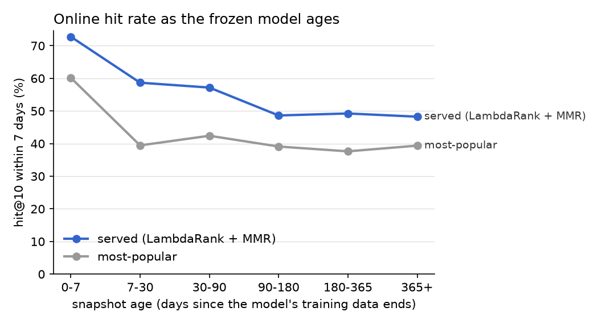

# Monitoring replay: ml-1m test period through the live serving path

Bundle 20261119-164040 (frozen at the end of val). Replayed 100,021 test-period interactions in time order; before each one the user requested recommendations with probability 0.05 (4,998 requests). Hit = the 10-item list contains at least one movie the user liked within the next 7 days (requests followed by no like are excluded). 'Popular' is the most-popular list for the same user at the same moment, evaluated on the same future.

| snapshot age (days) | requests | with future likes | hit@10 served | hit@10 popular | coverage | avg popularity | max PSI (noise floor) | major / moderate features |
|---|---|---|---|---|---|---|---|---|
| 0-7 | 450 | 437 | 63.4% | 60.2% | 5.6% | 1610 | 7.19 (0.002) | 8 / 3 |
| 7-30 | 612 | 588 | 48.0% | 39.5% | 8.3% | 1284 | 6.89 (0.001) | 7 / 4 |
| 30-90 | 771 | 738 | 56.4% | 42.4% | 9.0% | 1293 | 7.36 (0.000) | 7 / 3 |
| 90-180 | 736 | 693 | 47.9% | 39.1% | 10.6% | 1213 | 7.56 (0.000) | 7 / 3 |
| 180-365 | 986 | 922 | 44.7% | 37.6% | 10.2% | 1305 | 8.27 (0.000) | 7 / 1 |
| 365+ | 1443 | 1318 | 46.7% | 39.4% | 12.5% | 1282 | 8.27 (0.000) | 9 / 1 |

Overall hit@10 (7 days): served 49.7%, popular 41.4%.

### Most drifted features, snapshot age 0-7 days (4480 sampled rows)

| feature | PSI | status | training mean | serving mean |
|---|---|---|---|---|
| item_age_days | 7.192 | major | 213 | 248 |
| item_log_pop_7d | 6.269 | major | 3.85 | 2.04 |
| user_days_since_last | 5.598 | major | 15.2 | 0.635 |
| item_log_pop_30d | 1.360 | major | 4.94 | 4.25 |
| user_span_days | 0.839 | major | 26.4 | 27.7 |
| bpr_score | 0.595 | major | 2.66 | 266 |
| user_mean_log_pop | 0.404 | major | 5.87 | 6.13 |
| user_occupation | 0.371 | major | 10.2 | 9 |

### Most drifted features, snapshot age 7-30 days (6120 sampled rows)

| feature | PSI | status | training mean | serving mean |
|---|---|---|---|---|
| item_age_days | 6.894 | major | 213 | 261 |
| item_log_pop_7d | 6.421 | major | 3.85 | 1.87 |
| user_days_since_last | 4.283 | major | 15.2 | 1.93 |
| user_span_days | 3.943 | major | 26.4 | 81.5 |
| item_log_pop_30d | 1.647 | major | 4.94 | 4.06 |
| user_n_pos | 0.466 | major | 129 | 184 |
| user_n_ratings | 0.343 | major | 224 | 324 |
| user_mean_log_pop | 0.219 | moderate | 5.87 | 6 |

### Most drifted features, snapshot age 30-90 days (7710 sampled rows)

| feature | PSI | status | training mean | serving mean |
|---|---|---|---|---|
| item_age_days | 7.358 | major | 213 | 299 |
| item_log_pop_7d | 6.456 | major | 3.85 | 1.87 |
| user_span_days | 4.424 | major | 26.4 | 127 |
| user_days_since_last | 4.405 | major | 15.2 | 2.76 |
| item_log_pop_30d | 1.724 | major | 4.94 | 4.07 |
| user_n_pos | 0.371 | major | 129 | 195 |
| user_n_ratings | 0.348 | major | 224 | 337 |
| user_mean_log_pop | 0.237 | moderate | 5.87 | 5.99 |

### Most drifted features, snapshot age 90-180 days (7360 sampled rows)

| feature | PSI | status | training mean | serving mean |
|---|---|---|---|---|
| item_age_days | 7.564 | major | 213 | 379 |
| item_log_pop_7d | 6.453 | major | 3.85 | 1.84 |
| user_span_days | 6.138 | major | 26.4 | 200 |
| user_days_since_last | 4.057 | major | 15.2 | 5.37 |
| item_log_pop_30d | 1.789 | major | 4.94 | 4.02 |
| user_n_ratings | 0.641 | major | 224 | 381 |
| user_n_pos | 0.604 | major | 129 | 222 |
| user_mean_year | 0.239 | moderate | 1.99e+03 | 1.99e+03 |

### Most drifted features, snapshot age 180-365 days (9840 sampled rows)

| feature | PSI | status | training mean | serving mean |
|---|---|---|---|---|
| item_age_days | 8.268 | major | 213 | 505 |
| item_log_pop_7d | 6.486 | major | 3.85 | 1.86 |
| user_span_days | 5.996 | major | 26.4 | 336 |
| user_days_since_last | 3.718 | major | 15.2 | 7.06 |
| item_log_pop_30d | 1.804 | major | 4.94 | 4.04 |
| user_n_ratings | 0.437 | major | 224 | 356 |
| user_n_pos | 0.373 | major | 129 | 198 |
| x_sim_recent_mean | 0.152 | moderate | 0.384 | 0.337 |

### Most drifted features, snapshot age 365-10000 days (14430 sampled rows)

| feature | PSI | status | training mean | serving mean |
|---|---|---|---|---|
| item_age_days | 8.268 | major | 213 | 796 |
| item_log_pop_7d | 6.476 | major | 3.85 | 1.84 |
| user_span_days | 6.243 | major | 26.4 | 618 |
| user_days_since_last | 3.595 | major | 15.2 | 8.95 |
| item_log_pop_30d | 1.837 | major | 4.94 | 4.01 |
| user_n_ratings | 0.667 | major | 224 | 406 |
| user_n_pos | 0.609 | major | 129 | 229 |
| x_sim_recent_mean | 0.291 | major | 0.384 | 0.321 |
