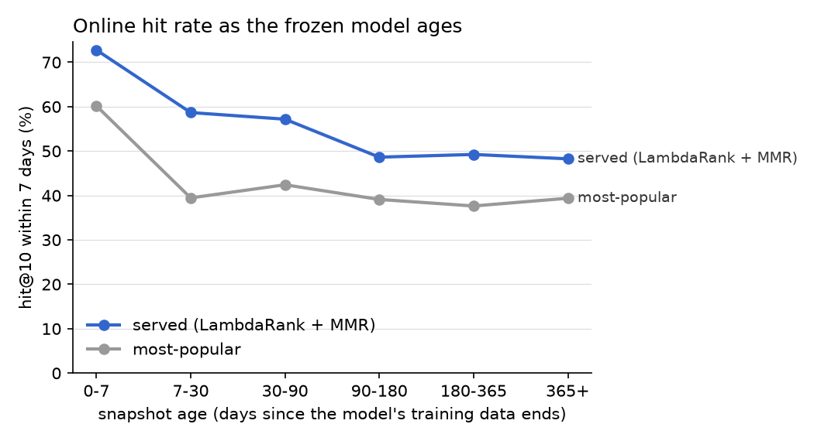

# Monitoring replay: ml-1m test period through the live serving path

Bundle 20261119-194330 (frozen at the end of val). Replayed 100,021 test-period interactions in time order; before each one the user requested recommendations with probability 0.05 (4,998 requests). Hit = the 10-item list contains at least one movie the user liked within the next 7 days (requests followed by no like are excluded). 'Popular' is the most-popular list for the same user at the same moment, evaluated on the same future.

| snapshot age (days) | requests | with future likes | hit@10 served | hit@10 popular | coverage | avg popularity | max PSI (noise floor) | major / moderate features |
|---|---|---|---|---|---|---|---|---|
| 0-7 | 450 | 437 | 73.5% | 60.2% | 16.0% | 1099 | 7.01 (0.004) | 5 / 6 |
| 7-30 | 612 | 588 | 61.7% | 39.5% | 22.0% | 880 | 7.12 (0.002) | 7 / 4 |
| 30-90 | 771 | 738 | 58.3% | 42.4% | 23.9% | 877 | 7.15 (0.002) | 9 / 3 |
| 90-180 | 736 | 693 | 47.2% | 39.1% | 25.2% | 786 | 7.16 (0.002) | 9 / 3 |
| 180-365 | 986 | 922 | 49.1% | 37.6% | 26.5% | 857 | 7.17 (0.002) | 7 / 4 |
| 365+ | 1443 | 1318 | 47.3% | 39.4% | 29.9% | 829 | 7.15 (0.001) | 9 / 3 |

Overall hit@10 (7 days): served 53.6%, popular 41.4%.

### Most drifted features, snapshot age 0-7 days (4480 sampled rows)

| feature | PSI | status | training mean | serving mean |
|---|---|---|---|---|
| item_log_pop_7d | 7.012 | major | 4.04 | 2.04 |
| item_log_pop_30d | 1.865 | major | 5.08 | 4.25 |
| user_days_since_last | 1.576 | major | 3.71 | 0.635 |
| user_span_days | 0.699 | major | 18.2 | 27.7 |
| user_mean_log_pop | 0.252 | major | 5.95 | 6.13 |
| user_n_ratings | 0.249 | moderate | 155 | 220 |
| user_occupation | 0.221 | moderate | 10 | 9 |
| user_n_pos | 0.210 | moderate | 90.6 | 120 |

### Most drifted features, snapshot age 7-30 days (6120 sampled rows)

| feature | PSI | status | training mean | serving mean |
|---|---|---|---|---|
| item_log_pop_7d | 7.122 | major | 4.04 | 1.87 |
| user_span_days | 5.088 | major | 18.2 | 81.5 |
| bpr_score | 2.401 | major | 2.62 | 2.55 |
| item_log_pop_30d | 2.213 | major | 5.08 | 4.06 |
| user_n_pos | 1.174 | major | 90.6 | 184 |
| user_n_ratings | 1.113 | major | 155 | 324 |
| user_days_since_last | 1.038 | major | 3.71 | 1.93 |
| user_mean_log_pop | 0.235 | moderate | 5.95 | 6 |

### Most drifted features, snapshot age 30-90 days (7710 sampled rows)

| feature | PSI | status | training mean | serving mean |
|---|---|---|---|---|
| item_log_pop_7d | 7.151 | major | 4.04 | 1.87 |
| user_span_days | 5.130 | major | 18.2 | 127 |
| bpr_score | 2.385 | major | 2.62 | 2.44 |
| item_log_pop_30d | 2.302 | major | 5.08 | 4.07 |
| user_n_pos | 1.163 | major | 90.6 | 195 |
| user_n_ratings | 1.077 | major | 155 | 337 |
| user_days_since_last | 1.008 | major | 3.71 | 2.76 |
| user_mean_log_pop | 0.303 | major | 5.95 | 5.99 |

### Most drifted features, snapshot age 90-180 days (7360 sampled rows)

| feature | PSI | status | training mean | serving mean |
|---|---|---|---|---|
| item_log_pop_7d | 7.161 | major | 4.04 | 1.84 |
| user_span_days | 6.248 | major | 18.2 | 200 |
| bpr_score | 3.119 | major | 2.62 | 2.47 |
| item_log_pop_30d | 2.381 | major | 5.08 | 4.02 |
| user_n_ratings | 1.489 | major | 155 | 381 |
| user_n_pos | 1.467 | major | 90.6 | 222 |
| user_days_since_last | 0.928 | major | 3.71 | 5.37 |
| user_mean_year | 0.271 | major | 1.99e+03 | 1.99e+03 |

### Most drifted features, snapshot age 180-365 days (9840 sampled rows)

| feature | PSI | status | training mean | serving mean |
|---|---|---|---|---|
| item_log_pop_7d | 7.172 | major | 4.04 | 1.86 |
| user_span_days | 6.373 | major | 18.2 | 336 |
| item_log_pop_30d | 2.384 | major | 5.08 | 4.04 |
| bpr_score | 1.956 | major | 2.62 | 2.5 |
| user_n_ratings | 1.177 | major | 155 | 356 |
| user_n_pos | 1.050 | major | 90.6 | 198 |
| user_days_since_last | 0.907 | major | 3.71 | 7.06 |
| x_sim_recent_mean | 0.212 | moderate | 0.393 | 0.337 |

### Most drifted features, snapshot age 365-10000 days (14430 sampled rows)

| feature | PSI | status | training mean | serving mean |
|---|---|---|---|---|
| item_log_pop_7d | 7.152 | major | 4.04 | 1.84 |
| user_span_days | 6.154 | major | 18.2 | 618 |
| item_log_pop_30d | 2.425 | major | 5.08 | 4.01 |
| bpr_score | 1.666 | major | 2.62 | 2.39 |
| user_n_ratings | 1.569 | major | 155 | 406 |
| user_n_pos | 1.423 | major | 90.6 | 229 |
| user_days_since_last | 0.717 | major | 3.71 | 8.95 |
| x_sim_recent_mean | 0.368 | major | 0.393 | 0.321 |
