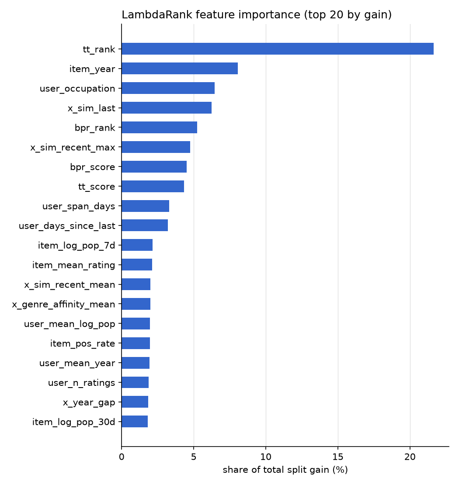

# Ranker (LightGBM LambdaRank): ml-1m

## Training data (windows)

| window | users | cutoff queries | session queries | candidates/query | positive rate | candidate recall (warm) | role |
|---|---|---|---|---|---|---|---|
| w1 | 1026 | 1026 | 2809 | 261 | 0.077 | 0.5587 | train |
| w2 | 1103 | 1103 | 2991 | 260 | 0.065 | 0.5781 | train + 25% holdout users |
| w3 | 1188 | 1188 | 0 | 270 | 0.087 | 0.5730 | test |

A cutoff query asks at the end of the window's history (the offline protocol); a session query asks at a random moment inside the label period, with the user's history up to that moment and frozen models, which is what the API serves.

## Hyperparameters (all queries of the held-out w2 users, cutoff + session; warm NDCG@10)

Rule: among grid points within 1% of the best held-out NDCG@10, serve the one with the lowest single-thread predict time per request (median over 200 held-out queries).

| params | trees | holdout warm NDCG@10 | predict ms / request | within tolerance | fit (s) |
|---|---|---|---|---|---|
| {"learning_rate": 0.05, "num_leaves": 31, "min_child_samples": 50} | 292 | 0.1922 | 6.68 | **selected** | 51 |
| {"learning_rate": 0.05, "num_leaves": 31, "min_child_samples": 200} | 369 | 0.1911 | 8.62 | yes | 56 |
| {"learning_rate": 0.05, "num_leaves": 63, "min_child_samples": 50} | 159 | 0.1888 | 4.91 |  | 43 |
| {"learning_rate": 0.05, "num_leaves": 63, "min_child_samples": 200} | 147 | 0.1875 | 4.49 |  | 41 |
| {"learning_rate": 0.1, "num_leaves": 31, "min_child_samples": 50} | 92 | 0.1894 | 2.45 |  | 25 |
| {"learning_rate": 0.1, "num_leaves": 31, "min_child_samples": 200} | 189 | 0.1902 | 3.73 |  | 35 |
| {"learning_rate": 0.1, "num_leaves": 63, "min_child_samples": 50} | 131 | 0.1851 | 3.67 |  | 37 |
| {"learning_rate": 0.1, "num_leaves": 63, "min_child_samples": 200} | 67 | 0.1864 | 2.34 |  | 27 |
| {"learning_rate": 0.2, "num_leaves": 31, "min_child_samples": 50} | 36 | 0.1833 | 1.53 |  | 22 |
| {"learning_rate": 0.2, "num_leaves": 31, "min_child_samples": 200} | 43 | 0.1804 | 1.49 |  | 20 |
| {"learning_rate": 0.2, "num_leaves": 63, "min_child_samples": 50} | 23 | 0.1863 | 1.26 |  | 19 |
| {"learning_rate": 0.2, "num_leaves": 63, "min_child_samples": 200} | 45 | 0.1827 | 1.84 |  | 26 |
| {"learning_rate": 0.3, "num_leaves": 31, "min_child_samples": 50} | 21 | 0.1795 | 1.24 |  | 19 |
| {"learning_rate": 0.3, "num_leaves": 31, "min_child_samples": 200} | 10 | 0.1799 | 0.88 |  | 16 |
| {"learning_rate": 0.3, "num_leaves": 63, "min_child_samples": 50} | 23 | 0.1765 | 1.19 |  | 18 |
| {"learning_rate": 0.3, "num_leaves": 63, "min_child_samples": 200} | 21 | 0.1834 | 1.34 |  | 18 |

## Training on session queries vs cutoff queries only (same selection)

| training queries | params | trees | held-out cutoff NDCG@10 | held-out session NDCG@10 | test NDCG@10 | test Recall@10 | test Recall@100 | test Coverage@10 |
|---|---|---|---|---|---|---|---|---|
| cutoff + session (served) | {"learning_rate": 0.05, "num_leaves": 31, "min_child_samples": 50} | 292 | 0.2796 | 0.1958 | 0.2550 | 0.1024 | 0.3682 | 0.1700 |
| cutoff only | {"learning_rate": 0.1, "num_leaves": 63, "min_child_samples": 200} | 37 | 0.2850 | 0.1677 | 0.2729 | 0.1029 | 0.3728 | 0.1267 |

The test protocol asks once, at the snapshot cutoff; serving asks mid-session. They reward different rankers. The served ranker is the one trained on both kinds of query; the test-period replay (reports/monitoring_*.md) compares the two online.

## Held-out w2 users, cutoff queries, all (n=275)

| Model | NDCG@10 | Recall@10 | Recall@20 | Recall@50 | Recall@100 | Coverage@10 |
|---|---|---|---|---|---|---|
| two-tower alone | 0.2495 | 0.0628 | 0.1082 | 0.2005 | 0.3165 | 0.0551 |
| BPR alone | 0.2687 | 0.0664 | 0.1163 | 0.2213 | 0.3287 | 0.0757 |
| LambdaRank on union | 0.2796 | 0.0923 | 0.1391 | 0.2426 | 0.3489 | 0.0585 |

## Held-out w2 users, cutoff queries, warm (n=131)

| Model | NDCG@10 | Recall@10 | Recall@20 | Recall@50 | Recall@100 | Coverage@10 |
|---|---|---|---|---|---|---|
| two-tower alone | 0.1410 | 0.0567 | 0.0940 | 0.1888 | 0.3177 | 0.0551 |
| BPR alone | 0.1607 | 0.0639 | 0.1095 | 0.2232 | 0.3393 | 0.0757 |
| LambdaRank on union | 0.1726 | 0.1110 | 0.1523 | 0.2587 | 0.3663 | 0.0585 |

Candidate recall (ceiling for any reordering): all 0.5303, warm 0.5580.

## Held-out w2 users, session queries, all (n=747)

| Model | NDCG@10 | Recall@10 | Recall@20 | Recall@50 | Recall@100 | Coverage@10 |
|---|---|---|---|---|---|---|
| two-tower alone | 0.1593 | 0.0714 | 0.1161 | 0.2148 | 0.3398 | 0.0708 |
| BPR alone | 0.1452 | 0.0562 | 0.1007 | 0.1925 | 0.2977 | 0.0809 |
| LambdaRank on union | 0.1958 | 0.1040 | 0.1599 | 0.2700 | 0.3803 | 0.1635 |

## Held-out w2 users, session queries, warm (n=727)

| Model | NDCG@10 | Recall@10 | Recall@20 | Recall@50 | Recall@100 | Coverage@10 |
|---|---|---|---|---|---|---|
| two-tower alone | 0.1579 | 0.0700 | 0.1139 | 0.2125 | 0.3380 | 0.0708 |
| BPR alone | 0.1441 | 0.0549 | 0.0978 | 0.1894 | 0.2950 | 0.0809 |
| LambdaRank on union | 0.1957 | 0.1038 | 0.1591 | 0.2684 | 0.3791 | 0.1635 |

Candidate recall (ceiling for any reordering): all 0.5525, warm 0.5518.

## Test (w3), all (n=1188)

| Model | NDCG@10 | Recall@10 | Recall@20 | Recall@50 | Recall@100 | Coverage@10 |
|---|---|---|---|---|---|---|
| two-tower alone | 0.2264 | 0.0671 | 0.1135 | 0.2097 | 0.3216 | 0.1156 |
| BPR alone | 0.2624 | 0.0756 | 0.1230 | 0.2311 | 0.3396 | 0.1679 |
| LambdaRank on union | 0.2550 | 0.1024 | 0.1568 | 0.2587 | 0.3682 | 0.1700 |

## Test (w3), warm (n=1159)

| Model | NDCG@10 | Recall@10 | Recall@20 | Recall@50 | Recall@100 | Coverage@10 |
|---|---|---|---|---|---|---|
| two-tower alone | 0.2219 | 0.0671 | 0.1135 | 0.2093 | 0.3210 | 0.1156 |
| BPR alone | 0.2573 | 0.0755 | 0.1228 | 0.2310 | 0.3397 | 0.1679 |
| LambdaRank on union | 0.2507 | 0.1030 | 0.1574 | 0.2592 | 0.3686 | 0.1700 |

Candidate recall (ceiling for any reordering): all 0.5719, warm 0.5730.

Phase 2 BPR test row for cross-check: NDCG@10 0.2624, Recall@100 0.3396.

## Feature importance (gain)

| feature | gain share | splits |
|---|---|---|
| tt_rank | 21.6% | 288 |
| item_year | 8.1% | 365 |
| user_occupation | 6.4% | 841 |
| x_sim_last | 6.3% | 354 |
| bpr_rank | 5.2% | 317 |
| x_sim_recent_max | 4.8% | 327 |
| bpr_score | 4.5% | 581 |
| tt_score | 4.3% | 299 |
| user_span_days | 3.3% | 432 |
| user_days_since_last | 3.2% | 284 |
| item_log_pop_7d | 2.2% | 302 |
| item_mean_rating | 2.1% | 286 |
| x_sim_recent_mean | 2.0% | 260 |
| x_genre_affinity_mean | 2.0% | 287 |
| user_mean_log_pop | 2.0% | 255 |
| item_pos_rate | 2.0% | 240 |
| user_mean_year | 1.9% | 280 |
| user_n_ratings | 1.9% | 290 |
| x_year_gap | 1.9% | 293 |
| item_log_pop_30d | 1.8% | 250 |
| user_mean_rating | 1.6% | 285 |
| user_n_pos | 1.6% | 233 |
| item_log_n_ratings | 1.6% | 234 |
| x_genre_affinity_max | 1.6% | 246 |
| x_pop_gap | 1.3% | 216 |

## Scoring cap (held-out w2 queries, cutoff + session)

Score only candidates some retriever ranked in its top `cap`; kept candidates keep every feature value. Rule: smallest cap within 1% of scoring all of them.

| cap | rows scored / query | held-out warm NDCG@10 |  |
|---|---|---|---|
| all | 260 | 0.1922 |  |
| 150 | 198 | 0.1912 |  |
| 120 | 161 | 0.1919 |  |
| 100 | 135 | 0.1913 |  |
| 80 | 109 | 0.1907 | **selected** |
| 60 | 83 | 0.1874 |  |
| 50 | 70 | 0.1830 |  |

Test, served ranker: all candidates NDCG@10 0.2550 / Recall@10 0.1024; capped at 80: 0.2599 / 0.0996, coverage@10 0.1638.

## MMR re-ranking of the top-50 (held-out w2 users, all users)

| lambda | NDCG@10 | Recall@10 | Coverage@10 | LongTail@10 | ILD (embedding)@10 | ILD (genre)@10 | ARP@10 |
|---|---|---|---|---|---|---|---|
| 1.0 | 0.2810 | 0.0879 | 0.0587 | 0.0091 | 0.2552 | 0.6278 | 1853 |
| 0.9 | 0.2793 | 0.0877 | 0.0600 | 0.0095 | 0.2592 | 0.6295 | 1850 |
| 0.8 | 0.2796 | 0.0889 | 0.0616 | 0.0098 | 0.2647 | 0.6371 | 1844 |
| 0.7 | 0.2761 | 0.0888 | 0.0641 | 0.0105 | 0.2729 | 0.6445 | 1832 |
| 0.5 | 0.2690 | 0.0861 | 0.0752 | 0.0142 | 0.2992 | 0.6706 | 1794 |
| 0.3 | 0.2397 | 0.0710 | 0.0984 | 0.0200 | 0.3696 | 0.6970 | 1639 |

## MMR re-ranking of the top-50 (test, all users)

| lambda | NDCG@10 | Recall@10 | Coverage@10 | LongTail@10 | ILD (embedding)@10 | ILD (genre)@10 | ARP@10 |
|---|---|---|---|---|---|---|---|
| 1.0 | 0.2599 | 0.0996 | 0.1638 | 0.0213 | 0.3402 | 0.6746 | 1625 |
| 0.9 | 0.2596 | 0.0995 | 0.1648 | 0.0216 | 0.3446 | 0.6765 | 1620 |
| 0.8 | 0.2602 | 0.0997 | 0.1682 | 0.0225 | 0.3513 | 0.6794 | 1614 |
| 0.7 | 0.2594 | 0.0994 | 0.1741 | 0.0232 | 0.3604 | 0.6831 | 1605 |
| 0.5 | 0.2540 | 0.0975 | 0.1996 | 0.0279 | 0.3947 | 0.6970 | 1553 |
| 0.3 | 0.2288 | 0.0829 | 0.2248 | 0.0395 | 0.4646 | 0.7228 | 1432 |

ILD = mean pairwise (1 - cosine) in the top list. The embedding version uses the same two-tower vectors MMR optimizes against; the genre version is an independent check.
