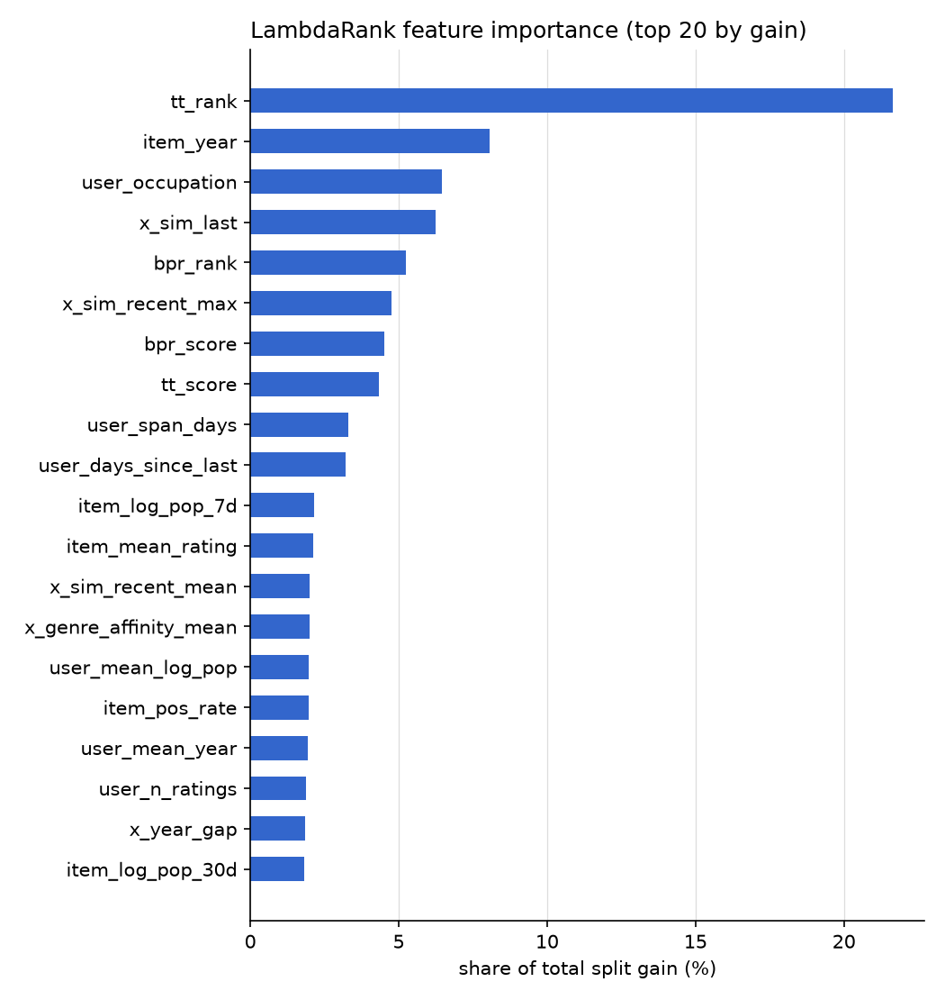

# Ranker (LightGBM LambdaRank): ml-1m

## Training data (windows)

| window | users | warm | candidates/user | positive rate | candidate recall (warm) | role |
|---|---|---|---|---|---|---|
| w1 | 1026 | 386 | 250 | 0.115 | 0.5639 | train |
| w2 | 1103 | 492 | 251 | 0.095 | 0.5890 | train + 25% holdout |
| w3 | 1188 | 1159 | 270 | 0.087 | 0.5730 | test |

## Hyperparameters (held-out w2 users, warm NDCG@10)

| params | best iteration | holdout warm NDCG@10 | fit (s) |
|---|---|---|---|
| {"num_leaves": 31, "min_child_samples": 50} | 23 | 0.1974 | 5 |
| {"num_leaves": 31, "min_child_samples": 200} | 53 | 0.1891 | 6 |
| {"num_leaves": 63, "min_child_samples": 50} | 46 | 0.1914 | 6 |
| {"num_leaves": 63, "min_child_samples": 200} | 26 | 0.1939 | 6 |

## Held-out w2 users (val period), all users (n=275)

| Model | NDCG@10 | Recall@10 | Recall@20 | Recall@50 | Recall@100 | Coverage@10 |
|---|---|---|---|---|---|---|
| two-tower alone | 0.2495 | 0.0628 | 0.1082 | 0.2005 | 0.3165 | 0.0551 |
| BPR alone | 0.2687 | 0.0664 | 0.1163 | 0.2213 | 0.3287 | 0.0757 |
| LambdaRank on union | 0.2857 | 0.0906 | 0.1416 | 0.2408 | 0.3516 | 0.0474 |

## Held-out w2 users (val period), warm users (n=131)

| Model | NDCG@10 | Recall@10 | Recall@20 | Recall@50 | Recall@100 | Coverage@10 |
|---|---|---|---|---|---|---|
| two-tower alone | 0.1410 | 0.0567 | 0.0940 | 0.1888 | 0.3177 | 0.0551 |
| BPR alone | 0.1607 | 0.0639 | 0.1095 | 0.2232 | 0.3393 | 0.0757 |
| LambdaRank on union | 0.1974 | 0.1129 | 0.1588 | 0.2524 | 0.3740 | 0.0474 |

Candidate recall (ceiling for any reordering): all 0.5303, warm 0.5580.

## Test (w3), all users (n=1188)

| Model | NDCG@10 | Recall@10 | Recall@20 | Recall@50 | Recall@100 | Coverage@10 |
|---|---|---|---|---|---|---|
| two-tower alone | 0.2264 | 0.0671 | 0.1135 | 0.2097 | 0.3216 | 0.1156 |
| BPR alone | 0.2624 | 0.0756 | 0.1230 | 0.2311 | 0.3396 | 0.1679 |
| LambdaRank on union | 0.2806 | 0.1018 | 0.1611 | 0.2672 | 0.3795 | 0.0950 |

## Test (w3), warm users (n=1159)

| Model | NDCG@10 | Recall@10 | Recall@20 | Recall@50 | Recall@100 | Coverage@10 |
|---|---|---|---|---|---|---|
| two-tower alone | 0.2219 | 0.0671 | 0.1135 | 0.2093 | 0.3210 | 0.1156 |
| BPR alone | 0.2573 | 0.0755 | 0.1228 | 0.2310 | 0.3397 | 0.1679 |
| LambdaRank on union | 0.2759 | 0.1023 | 0.1619 | 0.2678 | 0.3804 | 0.0950 |

Candidate recall (ceiling for any reordering): all 0.5719, warm 0.5730.

Phase 2 BPR test row for cross-check: NDCG@10 0.2624, Recall@100 0.3396.

## Feature importance (gain)

| feature | gain share | splits |
|---|---|---|
| bpr_rank | 34.4% | 73 |
| tt_rank | 18.0% | 59 |
| item_year | 14.4% | 50 |
| item_log_pop | 7.8% | 13 |
| item_age_days | 4.8% | 34 |
| user_days_since_last | 1.8% | 31 |
| user_span_days | 1.8% | 37 |
| user_occupation | 1.7% | 49 |
| user_mean_year | 1.5% | 27 |
| tt_score | 1.4% | 19 |
| item_log_pop_7d | 1.1% | 26 |
| user_n_ratings | 1.0% | 22 |
| item_log_pop_30d | 1.0% | 20 |
| x_genre_affinity_mean | 1.0% | 19 |
| x_year_gap | 0.9% | 23 |
| x_pop_gap | 0.9% | 17 |
| bpr_score | 0.8% | 17 |
| user_mean_log_pop | 0.7% | 24 |
| x_sim_recent_max | 0.6% | 17 |
| user_n_pos | 0.6% | 16 |
| user_mean_rating | 0.6% | 15 |
| x_sim_last | 0.5% | 16 |
| item_pos_rate | 0.5% | 12 |
| item_log_n_ratings | 0.4% | 9 |
| item_mean_rating | 0.4% | 6 |

## MMR re-ranking of the top-50 (held-out w2 users, all users)

| lambda | NDCG@10 | Recall@10 | Coverage@10 | LongTail@10 | ILD (embedding)@10 | ILD (genre)@10 | ARP@10 |
|---|---|---|---|---|---|---|---|
| 1.0 | 0.2857 | 0.0906 | 0.0474 | 0.0178 | 0.2501 | 0.6556 | 1863 |
| 0.9 | 0.2860 | 0.0918 | 0.0492 | 0.0175 | 0.2540 | 0.6627 | 1859 |
| 0.8 | 0.2857 | 0.0917 | 0.0502 | 0.0171 | 0.2594 | 0.6726 | 1855 |
| 0.7 | 0.2839 | 0.0909 | 0.0518 | 0.0171 | 0.2655 | 0.6750 | 1853 |
| 0.5 | 0.2776 | 0.0894 | 0.0623 | 0.0175 | 0.2918 | 0.6752 | 1839 |
| 0.3 | 0.2620 | 0.0838 | 0.0847 | 0.0247 | 0.3523 | 0.7051 | 1709 |

## MMR re-ranking of the top-50 (test, all users)

| lambda | NDCG@10 | Recall@10 | Coverage@10 | LongTail@10 | ILD (embedding)@10 | ILD (genre)@10 | ARP@10 |
|---|---|---|---|---|---|---|---|
| 1.0 | 0.2806 | 0.1018 | 0.0950 | 0.0256 | 0.3231 | 0.6873 | 1695 |
| 0.9 | 0.2800 | 0.1022 | 0.0968 | 0.0257 | 0.3276 | 0.6889 | 1691 |
| 0.8 | 0.2787 | 0.1022 | 0.1020 | 0.0258 | 0.3336 | 0.6920 | 1687 |
| 0.7 | 0.2775 | 0.1015 | 0.1084 | 0.0258 | 0.3424 | 0.6943 | 1678 |
| 0.5 | 0.2730 | 0.1009 | 0.1290 | 0.0288 | 0.3771 | 0.7047 | 1641 |
| 0.3 | 0.2465 | 0.0858 | 0.1736 | 0.0410 | 0.4558 | 0.7296 | 1513 |

ILD = mean pairwise (1 - cosine) in the top list. The embedding version uses the same two-tower vectors MMR optimizes against; the genre version is an independent check.
