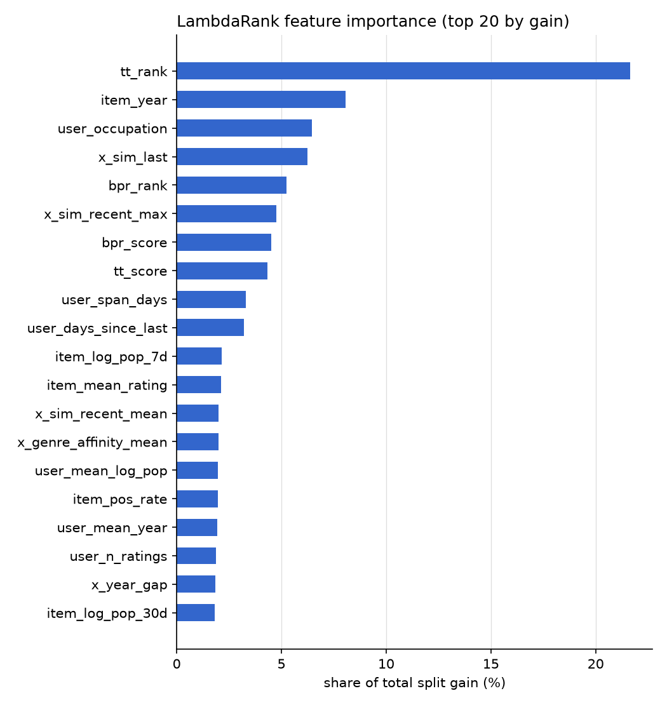

# Ranker (LightGBM LambdaRank): ml-1m

## Training data (windows)

| window | users | cutoff queries | session queries | candidates/query | positive rate | candidate recall (warm) | role |
|---|---|---|---|---|---|---|---|
| w1 | 1026 | 1026 | 2809 | 261 | 0.077 | 0.5587 | train |
| w2 | 1103 | 1103 | 2991 | 260 | 0.065 | 0.5781 | train + 25% holdout users |
| w3 | 1188 | 1188 | 0 | 270 | 0.087 | 0.5730 | test |

A cutoff query asks at the end of the window's history (the offline protocol); a session query asks at a random moment inside the label period, with the user's history up to that moment and frozen models, which is what the API serves.

## Hyperparameters (all queries of the held-out w2 users, cutoff + session; warm NDCG@10)

| params | best iteration | holdout warm NDCG@10 | fit (s) |
|---|---|---|---|
| {"num_leaves": 31, "min_child_samples": 50} | 292 | 0.1922 | 44 |
| {"num_leaves": 31, "min_child_samples": 200} | 369 | 0.1911 | 52 |
| {"num_leaves": 63, "min_child_samples": 50} | 159 | 0.1888 | 33 |
| {"num_leaves": 63, "min_child_samples": 200} | 147 | 0.1875 | 34 |

## Training on session queries vs cutoff queries only (same selection)

| training queries | params | trees | held-out cutoff NDCG@10 | held-out session NDCG@10 | test NDCG@10 | test Recall@10 | test Recall@100 | test Coverage@10 |
|---|---|---|---|---|---|---|---|---|
| cutoff + session (served) | {"num_leaves": 31, "min_child_samples": 50} | 292 | 0.2796 | 0.1958 | 0.2550 | 0.1024 | 0.3682 | 0.1700 |
| cutoff only | {"num_leaves": 63, "min_child_samples": 200} | 84 | 0.2854 | 0.1672 | 0.2790 | 0.1047 | 0.3742 | 0.1252 |

The test protocol asks once, at the snapshot cutoff; serving asks mid-session. They reward different rankers. The served ranker is the one trained on both kinds of query; the test-period replay (reports/monitoring_*.md) compares the two online.

## Held-out w2 users, cutoff queries, all (n=275)

| Model | NDCG@10 | Recall@10 | Recall@20 | Recall@50 | Recall@100 | Coverage@10 |
|---|---|---|---|---|---|---|
| two-tower alone | 0.2495 | 0.0628 | 0.1082 | 0.2005 | 0.3165 | 0.0551 |
| BPR alone | 0.2687 | 0.0664 | 0.1163 | 0.2213 | 0.3287 | 0.0757 |
| LambdaRank on union | 0.2796 | 0.0923 | 0.1391 | 0.2426 | 0.3489 | 0.0585 |

## Held-out w2 users, cutoff queries, warm (n=131)

| Model | NDCG@10 | Recall@10 | Recall@20 | Recall@50 | Recall@100 | Coverage@10 |
|---|---|---|---|---|---|---|
| two-tower alone | 0.1410 | 0.0567 | 0.0940 | 0.1888 | 0.3177 | 0.0551 |
| BPR alone | 0.1607 | 0.0639 | 0.1095 | 0.2232 | 0.3393 | 0.0757 |
| LambdaRank on union | 0.1726 | 0.1110 | 0.1523 | 0.2587 | 0.3663 | 0.0585 |

Candidate recall (ceiling for any reordering): all 0.5303, warm 0.5580.

## Held-out w2 users, session queries, all (n=747)

| Model | NDCG@10 | Recall@10 | Recall@20 | Recall@50 | Recall@100 | Coverage@10 |
|---|---|---|---|---|---|---|
| two-tower alone | 0.1593 | 0.0714 | 0.1161 | 0.2148 | 0.3398 | 0.0708 |
| BPR alone | 0.1452 | 0.0562 | 0.1007 | 0.1925 | 0.2977 | 0.0809 |
| LambdaRank on union | 0.1958 | 0.1040 | 0.1599 | 0.2700 | 0.3803 | 0.1635 |

## Held-out w2 users, session queries, warm (n=727)

| Model | NDCG@10 | Recall@10 | Recall@20 | Recall@50 | Recall@100 | Coverage@10 |
|---|---|---|---|---|---|---|
| two-tower alone | 0.1579 | 0.0700 | 0.1139 | 0.2125 | 0.3380 | 0.0708 |
| BPR alone | 0.1441 | 0.0549 | 0.0978 | 0.1894 | 0.2950 | 0.0809 |
| LambdaRank on union | 0.1957 | 0.1038 | 0.1591 | 0.2684 | 0.3791 | 0.1635 |

Candidate recall (ceiling for any reordering): all 0.5525, warm 0.5518.

## Test (w3), all (n=1188)

| Model | NDCG@10 | Recall@10 | Recall@20 | Recall@50 | Recall@100 | Coverage@10 |
|---|---|---|---|---|---|---|
| two-tower alone | 0.2264 | 0.0671 | 0.1135 | 0.2097 | 0.3216 | 0.1156 |
| BPR alone | 0.2624 | 0.0756 | 0.1230 | 0.2311 | 0.3396 | 0.1679 |
| LambdaRank on union | 0.2550 | 0.1024 | 0.1568 | 0.2587 | 0.3682 | 0.1700 |

## Test (w3), warm (n=1159)

| Model | NDCG@10 | Recall@10 | Recall@20 | Recall@50 | Recall@100 | Coverage@10 |
|---|---|---|---|---|---|---|
| two-tower alone | 0.2219 | 0.0671 | 0.1135 | 0.2093 | 0.3210 | 0.1156 |
| BPR alone | 0.2573 | 0.0755 | 0.1228 | 0.2310 | 0.3397 | 0.1679 |
| LambdaRank on union | 0.2507 | 0.1030 | 0.1574 | 0.2592 | 0.3686 | 0.1700 |

Candidate recall (ceiling for any reordering): all 0.5719, warm 0.5730.

Phase 2 BPR test row for cross-check: NDCG@10 0.2624, Recall@100 0.3396.

## Feature importance (gain)

| feature | gain share | splits |
|---|---|---|
| tt_rank | 21.6% | 288 |
| item_year | 8.1% | 365 |
| user_occupation | 6.4% | 841 |
| x_sim_last | 6.3% | 354 |
| bpr_rank | 5.2% | 317 |
| x_sim_recent_max | 4.8% | 327 |
| bpr_score | 4.5% | 581 |
| tt_score | 4.3% | 299 |
| user_span_days | 3.3% | 432 |
| user_days_since_last | 3.2% | 284 |
| item_log_pop_7d | 2.2% | 302 |
| item_mean_rating | 2.1% | 286 |
| x_sim_recent_mean | 2.0% | 260 |
| x_genre_affinity_mean | 2.0% | 287 |
| user_mean_log_pop | 2.0% | 255 |
| item_pos_rate | 2.0% | 240 |
| user_mean_year | 1.9% | 280 |
| user_n_ratings | 1.9% | 290 |
| x_year_gap | 1.9% | 293 |
| item_log_pop_30d | 1.8% | 250 |
| user_mean_rating | 1.6% | 285 |
| user_n_pos | 1.6% | 233 |
| item_log_n_ratings | 1.6% | 234 |
| x_genre_affinity_max | 1.6% | 246 |
| x_pop_gap | 1.3% | 216 |

## MMR re-ranking of the top-50 (held-out w2 users, all users)

| lambda | NDCG@10 | Recall@10 | Coverage@10 | LongTail@10 | ILD (embedding)@10 | ILD (genre)@10 | ARP@10 |
|---|---|---|---|---|---|---|---|
| 1.0 | 0.2796 | 0.0923 | 0.0585 | 0.0247 | 0.2555 | 0.6346 | 1795 |
| 0.9 | 0.2775 | 0.0926 | 0.0603 | 0.0251 | 0.2604 | 0.6352 | 1790 |
| 0.8 | 0.2773 | 0.0929 | 0.0608 | 0.0247 | 0.2655 | 0.6421 | 1787 |
| 0.7 | 0.2735 | 0.0899 | 0.0634 | 0.0251 | 0.2730 | 0.6478 | 1779 |
| 0.5 | 0.2673 | 0.0905 | 0.0755 | 0.0284 | 0.3029 | 0.6826 | 1738 |
| 0.3 | 0.2385 | 0.0697 | 0.0994 | 0.0404 | 0.3752 | 0.7097 | 1596 |

## MMR re-ranking of the top-50 (test, all users)

| lambda | NDCG@10 | Recall@10 | Coverage@10 | LongTail@10 | ILD (embedding)@10 | ILD (genre)@10 | ARP@10 |
|---|---|---|---|---|---|---|---|
| 1.0 | 0.2550 | 0.1024 | 0.1700 | 0.0433 | 0.3359 | 0.6804 | 1494 |
| 0.9 | 0.2539 | 0.1017 | 0.1741 | 0.0434 | 0.3424 | 0.6825 | 1490 |
| 0.8 | 0.2543 | 0.1021 | 0.1803 | 0.0441 | 0.3502 | 0.6848 | 1488 |
| 0.7 | 0.2535 | 0.1017 | 0.1870 | 0.0455 | 0.3609 | 0.6879 | 1483 |
| 0.5 | 0.2477 | 0.0987 | 0.2168 | 0.0519 | 0.4005 | 0.6982 | 1453 |
| 0.3 | 0.2218 | 0.0809 | 0.2498 | 0.0678 | 0.4747 | 0.7210 | 1357 |

ILD = mean pairwise (1 - cosine) in the top list. The embedding version uses the same two-tower vectors MMR optimizes against; the genre version is an independent check.
